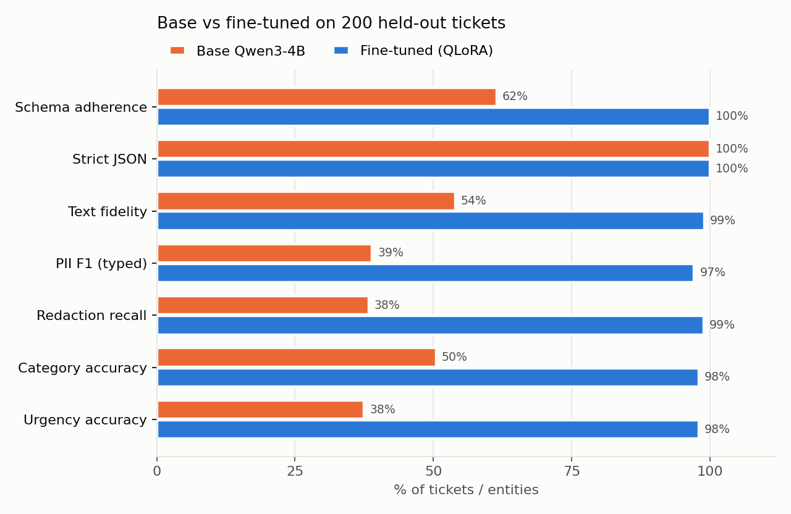
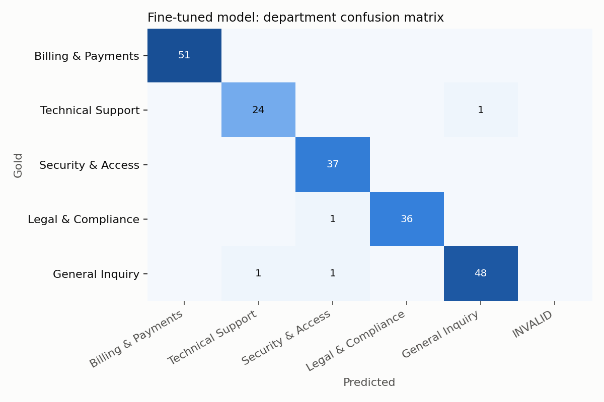
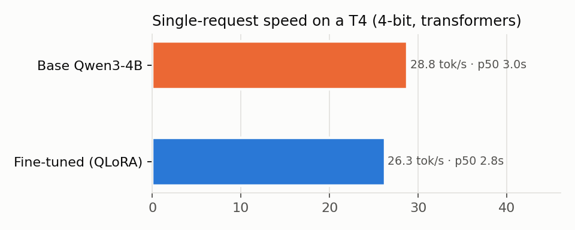
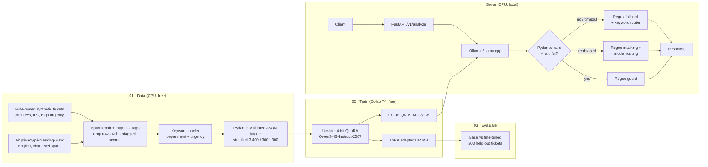

# Localized Enterprise PII Masker & Ticket Categorizer

**A 4B-parameter open model, fine-tuned for $0 on a free Colab T4, that masks PII in support tickets and routes them to the right department, returning strict JSON. It runs locally on CPU through Ollama.**

[](https://github.com/zainabbas14/slm-pii-masker/actions/workflows/ci.yml)
[](https://huggingface.co/Zain9989/pii-masker-qwen3-4b-lora)
[](https://huggingface.co/Zain9989/pii-masker-qwen3-4b-GGUF)
[](https://huggingface.co/datasets/Zain9989/enterprise-pii-ticket-sft)


> **The untuned model leaked 62% of PII values. The fine-tuned model leaks 1.1%, and a deterministic regex guard sits behind it.**

Example:

```
IN   Hi, I'm Omar Haddad. I was charged twice on my card 4111 1111 1111 1111, please refund ASAP. omar@contoso.io
OUT  {"masked_text": "Hi, I'm [PERSON]. I was charged twice on my card [CREDIT_CARD], please refund ASAP. [EMAIL]",
      "detected_pii_types": ["PERSON", "EMAIL", "CREDIT_CARD"],
      "ticket_category": "Billing_and_Payments",
      "urgency_level": "High"}
```

---

## Why this exists

Support, HR and legal teams want LLMs to triage tickets, but tickets are full of names, card numbers, SSNs and leaked credentials. Sending them to a third-party API creates a compliance problem, and paying frontier-model prices for routine routing makes little economic sense.

This project shows the alternative: **a small open model, specialised by fine-tuning, that runs on hardware you control.** One forward pass does two jobs, redaction and routing, and returns machine-readable output that downstream systems can trust because it is validated against a strict schema.

| | Frontier API | This project |
|---|---|---|
| Data leaves your network | Yes | **No** (runs on CPU via Ollama) |
| Cost per ticket | Per-token billing | **$0** after a free training run |
| Output contract | Prompted, best-effort | **Fine-tuned + Pydantic-validated + regex guard** |
| Model size | Hundreds of GB | **2.3 GB** GGUF |

## Results

Benchmarked in [`notebooks/03_evaluation_benchmark.ipynb`](notebooks/03_evaluation_benchmark.ipynb) on **200 held-out test tickets** neither model saw. Both models got the identical system prompt, greedy decoding and 4-bit weights on a Tesla T4.

| Metric | Base Qwen3-4B | Fine-tuned (QLoRA) |
|---|---:|---:|
| Strict JSON (raw output is pure JSON) | 100.0% | **100.0%** |
| Schema adherence (Pydantic) | 61.5% | **100.0%** |
| Text fidelity (no rephrasing) | 54.0% | **99.0%** |
| PII precision (typed, exact span) | 60.7% | **97.9%** |
| PII recall (typed, exact span) | 28.7% | **96.5%** |
| PII F1 (typed, exact span) | 39.0% | **97.2%** |
| **Redaction recall (PII values not leaked)** | 38.4% | **98.9%** |
| Department accuracy | 50.5% | **98.0%** |
| Department macro-F1 | 60.2% | **97.8%** |
| Urgency accuracy | 37.5% | **98.0%** |
| Tokens/sec (single request, T4, transformers) | 28.8 | 26.3 |
| Latency p50 / p95 | 2.96 s / 3.89 s | 2.76 s / 3.76 s |



**What the numbers say**

- **JSON syntax was never the problem.** The base model already emits valid JSON every time. It fails on *what goes inside*: invented category names, tag lists that don't match the text, and rewriting the ticket instead of masking it. Fine-tuning fixes the contract, not the syntax.
- **Redaction recall is the business metric.** It counts how many real PII values (names, cards, emails…) are absent from the output. The base model left 61.6% of them in clear text.
- **PII scoring is strict.** A predicted `[EMAIL]` only counts if it replaces exactly the e-mail's characters, under the right tag. Outputs that rephrase the ticket get no credit at all.
- **Speed is unchanged.** The adapter adds ~9% per-token overhead when run unmerged. The GGUF build has the adapter merged into the weights, so it doesn't pay that cost.

<details>
<summary>Department confusion matrix and speed chart</summary>



</details>

## Architecture



**Defence in depth.** The model is the primary detector, but the API never trusts it blindly:

| Path (`meta.source`) | When | What happens |
|---|---|---|
| `model` | Output is schema-valid and only swaps PII for tags | Returned as-is |
| `model+regex_guard` | …but regex still finds an e-mail, SSN, Luhn-valid card, IP, API key or phone | Guard masks it; `meta.guard_added_types` says what the model missed |
| `hybrid` | Output is valid but the text was rephrased | Masking rebuilt deterministically from the source; the model's routing is kept |
| `regex_fallback` | Model unreachable, timed out, or output fails validation | Fully deterministic masking + keyword routing; always schema-valid |

Raw ticket text is never logged; logs contain only the path taken, character count, PII types and latency.

## Dataset

Built in [`notebooks/01_data_preparation.ipynb`](notebooks/01_data_preparation.ipynb) and published at [`Zain9989/enterprise-pii-ticket-sft`](https://huggingface.co/datasets/Zain9989/enterprise-pii-ticket-sft).

- **Source:** the English subset of [`ai4privacy/pii-masking-200k`](https://huggingface.co/datasets/ai4privacy/pii-masking-200k), which provides character-offset PII spans. Offsets are validated and repaired when they are off by a few characters, and the source labels are mapped onto the 7 target tags. First, middle and last names separated only by spaces collapse into a single `[PERSON]`.
- **Rows with untagged secrets are dropped, not kept.** Passwords, IBANs, CVVs and crypto wallets have no tag in this schema. Leaving them in clear text inside training targets would teach the model that secrets may pass through.
- **Synthetic augmentation (20%, no paid LLM).** The public corpus has no API keys and few explicitly urgent tickets, so hand-written enterprise templates fill those gaps. Card numbers are Luhn-valid test ranges, phone numbers use the reserved 555-01XX range, e-mail domains are fictitious, and keys use non-provider prefixes so secret scanners don't flag the dataset.
- **Quality gates:** Pydantic validation of every target, a check that `masked_text` equals the source except for tags, a leak check, de-duplication across splits, and token lengths measured with the real chat template (p50 379, p95 453, max 567).
- **Splits:** 3,400 train / 300 validation / 300 test, stratified on department × urgency.

## Training

[`notebooks/02_qlora_finetuning_unsloth.ipynb`](notebooks/02_qlora_finetuning_unsloth.ipynb). Training metrics: [W&B run](https://wandb.ai/za488778-zelulabs/slm-pii-masker/runs/zt81un21).

| | |
|---|---|
| Base model | [`Qwen/Qwen3-4B-Instruct-2507`](https://huggingface.co/Qwen/Qwen3-4B-Instruct-2507) (Apache-2.0) via Unsloth's 4-bit build |
| Method | QLoRA, r=16, α=32, all attention + MLP projections; **33.0M trainable params (0.81%)** |
| Loss | Assistant tokens only: the model learns the JSON answer, not the system prompt |
| Schedule | 2 epochs, 850 steps, effective batch 8, LR 2e-4 cosine, 8-bit AdamW, fp16 |
| Hardware | Free Colab Tesla T4: **95 min, 4.05 GB peak VRAM** of 15 GB |
| Validation loss | 0.0237 (step 50) → **0.0036** (step 800); best checkpoint kept |
| Resilience | Checkpoints to Google Drive every 100 steps; re-running resumes after a disconnect |

Choices that mattered:

- **Qwen3-4B-Instruct-2507 rather than Qwen2.5-3B.** Qwen2.5-3B ships under a research licence that disallows commercial use. Qwen3-4B-Instruct-2507 is Apache-2.0.
- **A plain ChatML template.** Unsloth's Qwen3 tokenizer inherits the hybrid "thinking" template, which inserts an empty `<think></think>` block before every reply. Training on that would bake think tags into every answer and into the GGUF, so the notebook replaces it and asserts the result.
- **`repeat_penalty 1.0` at serving time.** Ollama's default (1.1) penalises copying, and verbatim copying is most of this task.

## Run it locally

Commands below are for Linux / WSL2. No GPU needed; the Q4_K_M model needs ~3 GB of RAM.

```bash
git clone https://github.com/zainabbas14/slm-pii-masker.git && cd slm-pii-masker

# 1. Install Ollama and register the model
curl -fsSL https://ollama.com/install.sh | sh
pip install -U huggingface_hub
hf download Zain9989/pii-masker-qwen3-4b-GGUF pii-masker-qwen3-4b-Q4_K_M.gguf --local-dir models
ollama create pii-masker -f Modelfile

# 2. Start the API
python -m venv .venv && source .venv/bin/activate
pip install -r requirements.txt
cp .env.example .env
uvicorn app.inference_server:app --host 0.0.0.0 --port 8000
```

```bash
curl -s localhost:8000/v1/analyze -H 'content-type: application/json' -d '{
  "text": "URGENT: our dev Priya Sharma pushed key api_9fK2mQx7LpR4tZ8vW1yN3bC6dE0gH5jA to a public repo. Call +1 (415) 555-0132."
}' | python -m json.tool
```

Interactive API docs are at <http://localhost:8000/docs>; `GET /health` reports whether the model is reachable.

**Measured on a laptop CPU** (WSL2, Ollama, Q4_K_M, no GPU): **~10–11 s per ticket** once the model is loaded, ~35 s for the very first request. Schema-constrained decoding (`OLLAMA_FORMAT=schema`) added no measurable latency and produced identical output.

**Other modes** (set in `.env`):

- `BACKEND=llamacpp`: point the API at `llama-server -m models/pii-masker-qwen3-4b-Q4_K_M.gguf --port 8080 --temp 0 --repeat-penalty 1.0`.
- `BACKEND=rules_only`: run without any model to try the deterministic fallback.
- `OLLAMA_FORMAT=schema`: constrains decoding to the Pydantic JSON schema (default).

**Colab demo:** [`notebooks/04_gradio_demo.ipynb`](notebooks/04_gradio_demo.ipynb) runs the fine-tuned model behind the same `app/` pipeline in a Gradio UI with a public share link, including a toggle that simulates a model outage.

## Tests

```bash
pytest        # 81 tests, no model or GPU needed
ruff check app tests
```

The suite covers JSON extraction (code fences, chatter, escaped braces), schema rejection rules, tag/type consistency, the faithfulness check, every regex detector including false-positive cases, routing, every API path (`model`, guard, `hybrid`, each fallback reason), input validation, and a check that the `Modelfile` system prompt matches `configs/prompt_config.json`. CI runs it on Python 3.11 and 3.12.

## Repository layout

```
├── app/
│   ├── schemas.py            # output contract, JSON extraction, faithfulness check
│   ├── regex_fallback.py     # deterministic detectors, guard, keyword router
│   └── inference_server.py   # FastAPI service, Ollama / llama.cpp backends
├── configs/prompt_config.json   # system prompt + label vocabularies, shared by every stage
├── notebooks/
│   ├── 01_data_preparation.ipynb
│   ├── 02_qlora_finetuning_unsloth.ipynb
│   ├── 03_evaluation_benchmark.ipynb
│   └── 04_gradio_demo.ipynb
├── tests/test_schema_and_fallback.py
├── Modelfile                 # Ollama: GGUF + ChatML template + system prompt
├── requirements.txt          # API + tests (pinned)
└── requirements-colab.txt    # versions used for the training run
```

## Limitations

- **Masking is typed redaction, not anonymisation.** Seven PII types are replaced by tags; addresses, dates, ages and job titles are left in place and can still identify someone. Two different people both become `[PERSON]`.
- **Department and urgency labels on real rows are weak labels.** The public corpus has no routing labels, so they come from a transparent keyword labeler with an ambiguity filter; the 20% synthetic rows carry true labels. On real rows, accuracy partly measures agreement with that labeler. `eval/predictions.parquet` on the Hub has an `origin` column to split the two.
- **English only, and mostly synthetic text.** ai4privacy is itself generated data, so real tickets will be messier than the test set. Expect lower numbers on production traffic until the model is evaluated on in-domain samples.
- **The regex fallback finds names only after cues** such as "Mr." or "my name is". In fallback mode, PERSON recall is deliberately conservative.

## Roadmap

- Indexed pseudonyms (`[PERSON_1]`, `[PERSON_2]`) with an optional encrypted re-identification vault
- Evaluate the GGUF build through Ollama on the full 200-ticket test set, not just the adapter in transformers
- Retrain with a much shorter system prompt to cut CPU prompt-processing time
- Extra tags: addresses, dates of birth, IBANs, passport numbers
- Docker image and a load test on CPU

## Licence

Code: Apache-2.0. Base model: Apache-2.0 ([Qwen3-4B-Instruct-2507](https://huggingface.co/Qwen/Qwen3-4B-Instruct-2507)). Source data: see the [ai4privacy dataset card](https://huggingface.co/datasets/ai4privacy/pii-masking-200k) for its terms.
